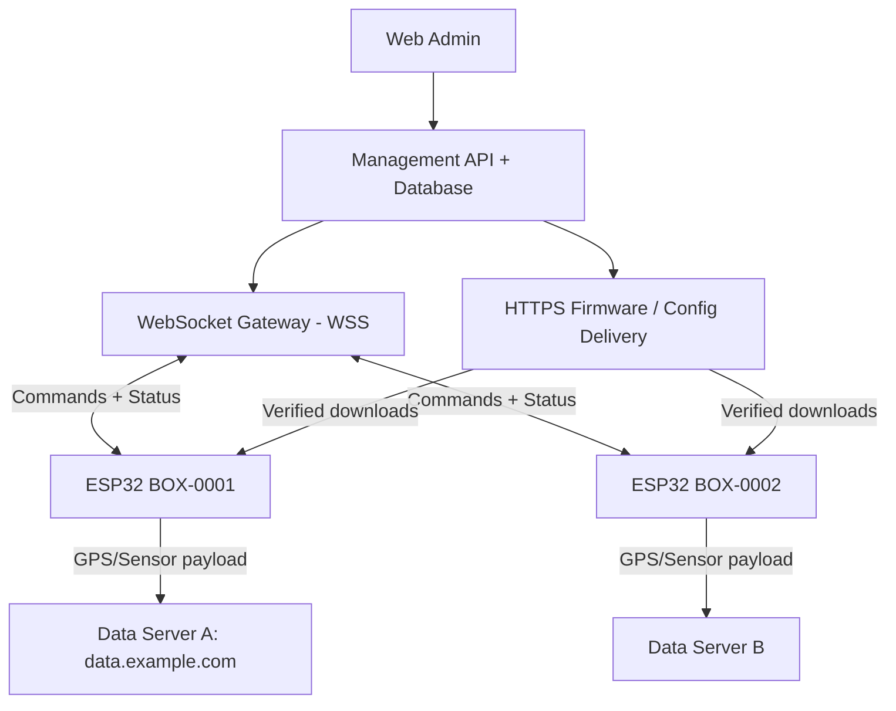

# ESP32 Central Device Management — System Specification

> Version: 1.1 · Updated: 2026-10-18 · Status: Implementation blueprint

## 1. เป้าหมายระบบ

สร้าง **Central Management Server** เพื่อจัดการกล่อง ESP32 ทุกตัวผ่าน Device ID แยกกัน โดยรองรับ:

- Firmware OTA: เพิ่ม/ปรับความสามารถกล่อง (v1.0.0 รองรับ GPS ตั้งแต่แรก และ v1.1.0 เพิ่มการตรวจจับความเร็วเกินค่าที่กำหนด)
- Remote Configuration: ปรับค่าทำงานของ Firmware โดยไม่ต้องแฟลชใหม่
- Schema-Driven Configuration: เว็บสร้างฟอร์มตามพารามิเตอร์ที่ Firmware รุ่นนั้นรองรับ
- WebSocket Trigger: Server ส่งคำสั่งไปยังกล่องที่ออนไลน์แบบทันที
- Offline Job / Reconciliation: กล่องที่ออฟไลน์กลับมาแล้วดึงคำสั่งที่ค้างได้
- รายงานสถานะและผลการอัปเดต (Device Status, Command Status)

**ขอบเขตที่ต้องแยกให้ชัด:** Management WebSocket ใช้เฉพาะบริหารกล่อง ส่วนข้อมูล GPS/Sensor ถูกส่งจากกล่องไปยัง **Data Server ที่กำหนดใน Config โดยตรง** (เช่น `https://data.example.com/api/gps`) ไม่วิ่งผ่าน Central Management Server

## 2. ภาพรวมสถาปัตยกรรม



### Management Plane (ส่วนกลาง)

- Endpoint ตัวอย่าง: `wss://management.example.com/ws/device`
- ทำหน้าที่ authenticate กล่อง, register connection, heartbeat, trigger command, รับ acknowledgement/progress/result
- กล่องทุกตัวมี bootstrap settings สำหรับ Management Server และ device credential ของตนเอง
- การเปลี่ยน Management Server ต้องมีขั้นตอน migration/fallback ที่ปลอดภัย ไม่ผูกกับ data_server config

### Data Plane (แยกต่างหาก)

- Protocol เช่น HTTPS / MQTT / TCP / WebSocket ตามที่ Firmware module รองรับ
- Target endpoint ตั้งผ่าน `data_server` ใน Config แต่ละ Device ID
- Management Server ไม่จำเป็นต้องรับหรือ forward GPS
- การเปลี่ยน Data Server ไม่กระทบ connection ไปยัง Management Server

## 3. นิยามข้อมูลหลัก

| ชื่อ | ความหมาย |
|---|---|
| `device_id` | รหัสกล่องถาวร เช่น `BOX-0001` (ไม่ใช่ credential) |
| `hardware_model` | รุ่นบอร์ด/ฮาร์ดแวร์ ใช้เลือก Firmware ที่รองรับ |
| `firmware_version` | เวอร์ชันโปรแกรมที่กำลังทำงานจริง เช่น `1.1.0` |
| `schema_version` | เวอร์ชันนิยาม Parameter ที่กล่องรองรับ |
| `config_version` | เวอร์ชัน Config ที่ใช้จริงในกล่อง (แยกจากเวอร์ชันที่ Server ต้องการ) |
| `desired_config` | ค่า Config เป้าหมายใน Server |
| `reported_config` | ค่า Config ที่กล่องรายงานว่า apply แล้ว |
| `command_id` | ID คำสั่ง unique สำหรับ idempotency/retry |
| `job_id` | ID งานอัปเดตที่บันทึกในฐานข้อมูล |

## 4. Firmware vs Schema vs Config

1. **Firmware** คือ code/feature ที่กล่องทำได้จริง เช่นอ่าน GPS, ส่งข้อมูล, เปิด LED, รองรับ OTA
2. **Parameter Schema** คือรายการค่าที่ผู้ดูแลปรับได้ รวม type, default, validation, กลุ่ม, options, requirement, compatibility
3. **Device Config** คือค่าที่ตั้งเฉพาะกล่อง เช่น GPS เปิดไหม, ส่งถี่แค่ไหน, server ปลายทางใด

ตัวอย่างความต่าง:

| Function / Parameter | Firmware v1.0.0 | Firmware v1.1.0 |
|---|---|---|
| OTA + WebSocket Management | รองรับ | รองรับ |
| LED enabled | รองรับ | รองรับ |
| Send interval | รองรับ | รองรับ |
| GPS enabled / baud rate | รองรับ | รองรับ |
| Data server สำหรับ GPS | รองรับ | รองรับ |
| กำหนดความเร็วสูงสุด `speed_limit_kmh` | ไม่รองรับ | รองรับ |
| ตรวจจับ/แจ้งเตือนเมื่อเกินความเร็วที่ตั้ง | ไม่รองรับ | รองรับ |

**ข้อจำกัดฮาร์ดแวร์:** v1.0.0 มีโค้ดรองรับ GPS อยู่แล้ว แต่การอ่านพิกัดจริงต้องมีโมดูล GPS ต่อเข้ากล่อง หรือมีแหล่งข้อมูลพิกัดอื่นที่รองรับ ทั้งนี้ฟังก์ชัน `speed_limit_kmh` ของ v1.1.0 เป็น **เกณฑ์ตรวจสอบ/แจ้งเตือนความเร็วเกิน** ไม่ใช่การสั่งจำกัดความเร็วรถทางกายภาพหรือควบคุมคันเร่ง/ECU

## 5. ตัวอย่าง Parameter Schema ตาม Firmware

ควรเผยแพร่ Schema เป็น artifact ที่จับคู่กับ Firmware release และ hardware model ไม่จำเป็นต้องส่ง schema ทั้งหมดจากกล่องทุกครั้ง ตัวอย่างกำหนดให้ `schema_version=1` เป็นของ Firmware v1.0.0 และ `schema_version=2` เป็นของ Firmware v1.1.0

### 5.1 Firmware v1.0.0 — รองรับ GPS ตั้งแต่เวอร์ชันแรก

```json
{
  "hardware_model": "ESP32-DEVKIT-V1",
  "firmware_version": "1.0.0",
  "schema_version": 1,
  "parameters": [
    {"key": "led.enabled", "label": "เปิดไฟ LED", "type": "boolean", "default": true},
    {"key": "gps.enabled", "label": "เปิด GPS", "type": "boolean", "default": true},
    {"key": "gps.baud_rate", "label": "GPS Baud Rate", "type": "enum", "options": [4800, 9600, 38400], "default": 9600, "visible_when": {"gps.enabled": true}},
    {"key": "gps.send_interval_sec", "label": "รอบส่ง GPS (วินาที)", "type": "integer", "min": 5, "max": 3600, "default": 10},
    {"key": "data_server.protocol", "label": "โปรโตคอลส่งข้อมูล", "type": "enum", "options": ["https"], "default": "https"},
    {"key": "data_server.host", "label": "โฮสต์ปลายทาง", "type": "hostname", "required": true},
    {"key": "data_server.port", "label": "พอร์ต", "type": "integer", "min": 1, "max": 65535, "default": 443},
    {"key": "data_server.path", "label": "API Path", "type": "string", "default": "/api/gps"}
  ]
}
```

### 5.2 Firmware v1.1.0 — เพิ่มเกณฑ์ความเร็วสูงสุด

Schema v1.1.0 ต้อง **คงทุก Parameter จาก v1.0.0** และเพิ่ม Parameter นี้:

```json
{
  "hardware_model": "ESP32-DEVKIT-V1",
  "firmware_version": "1.1.0",
  "schema_version": 2,
  "inherits": "1.0.0",
  "additional_parameters": [
    {
      "key": "speed_limit.enabled",
      "label": "เปิดตรวจสอบความเร็วเกิน",
      "type": "boolean",
      "default": false
    },
    {
      "key": "speed_limit.max_kmh",
      "label": "ความเร็วสูงสุดที่อนุญาต (กม./ชม.)",
      "type": "number",
      "min": 1,
      "max": 200,
      "default": 80,
      "unit": "km/h",
      "visible_when": {"speed_limit.enabled": true}
    }
  ]
}
```

`inherits` / `additional_parameters` เป็นรูปแบบเอกสารเพื่อให้อ่านง่าย: Backend ต้อง resolve เป็น Schema เต็มก่อนนำไปสร้างฟอร์มและตรวจ Config หาก Schema engine ไม่รองรับ inheritance ให้เก็บ Parameter ทั้งหมดของ v1.1.0 แทน โดยห้ามทำพารามิเตอร์ของ v1.0.0 หายไป

**การทำงาน:** เมื่อ GPS มี speed fix ที่ใช้ได้ กล่องเปรียบเทียบความเร็วปัจจุบัน (`speed_kmh`) กับ `speed_limit.max_kmh` ถ้า `speed_kmh > max_kmh` ให้สร้างเหตุการณ์ `OVERSPEED` ส่งไปยัง **Data Server ที่อยู่ใน Config** (หรือช่องทางแจ้งเตือนที่ Data Server รองรับ) แนะนำ hysteresis/ช่วงเวลายืนยันก่อนแจ้ง เพื่อเลี่ยงการแจ้งเตือนซ้ำจากสัญญาณ GPS แกว่ง โดยต้องกำหนดรูปแบบ event ร่วมกับ Data Server

**ความถูกต้อง:** UI validation เป็นเพียงชั้นแรก Backend และ ESP32 ต้องตรวจสอบ type/range/feature/support อีกครั้ง ค่าความเร็วสูงสุดเป็นเพียง threshold แจ้งเตือน ไม่ได้บังคับรถให้ลดความเร็วจริง

## 6. ตัวอย่าง Device Config

### 6.1 BOX-0001 — Firmware v1.0.0 (GPS)

```json
{
  "device_id": "BOX-0001",
  "schema_version": 1,
  "config_version": 5,
  "settings": {
    "led": {"enabled": true},
    "gps": {"enabled": true, "baud_rate": 9600, "send_interval_sec": 10},
    "data_server": {
      "protocol": "https",
      "host": "data.example.com",
      "port": 443,
      "path": "/api/gps"
    }
  }
}
```

### 6.2 BOX-0002 — Firmware v1.1.0 (GPS + ความเร็วสูงสุด)

```json
{
  "device_id": "BOX-0002",
  "schema_version": 2,
  "config_version": 7,
  "settings": {
    "led": {"enabled": true},
    "gps": {"enabled": true, "baud_rate": 9600, "send_interval_sec": 10},
    "speed_limit": {"enabled": true, "max_kmh": 80},
    "data_server": {
      "protocol": "https",
      "host": "data.example.com",
      "port": 443,
      "path": "/api/gps"
    }
  }
}
```

ผลคือทั้งสองกล่องส่ง GPS ไป `https://data.example.com/api/gps` ทุก 10 วินาที **เมื่อ** มีฮาร์ดแวร์/พิกัดพร้อมใช้งาน เชื่อมต่ออินเทอร์เน็ต และปลายทางรองรับ API; ส่วน BOX-0002 ตรวจความเร็วเกิน 80 กม./ชม. เพิ่มด้วย และ BOX-0001 จะไม่ได้รับฟิลด์ `speed_limit` เพราะ Firmware v1.0.0 ยังไม่รองรับ

ตัวอย่าง GPS payload (ข้อมูลจำลอง):

```json
{
  "device_id": "BOX-0002",
  "latitude": 13.599100,
  "longitude": 100.596500,
  "speed_kmh": 85.0,
  "timestamp": "2026-10-18T07:00:00Z"
}
```

ตัวอย่าง event แจ้งเตือนจาก v1.1.0 เมื่อเกินเกณฑ์:

```json
{
  "device_id": "BOX-0002",
  "event_type": "OVERSPEED",
  "speed_kmh": 85.0,
  "speed_limit_kmh": 80.0,
  "timestamp": "2026-10-18T07:00:00Z"
}
```

Event นี้เป็น **ตัวอย่างสัญญาข้อมูล** ที่ต้องตกลงกับ Data Server ก่อนนำไปใช้ ไม่ส่ง event GPS ผ่าน Management WebSocket

**Credential สำหรับส่งข้อมูล** ควรจัดเก็บเป็นความลับแยกจาก config ที่เว็บแสดง ไม่บันทึก token plain text ใน log และไม่รับ target host ที่ไม่ได้รับอนุญาต (allowlist/validation) เพื่อป้องกัน SSRF และ exfiltration

## 7. WebSocket Command Protocol

### 7.1 การเชื่อมต่อ

- กล่องเปิด WSS connection ออกไปหา Server กลาง (ไม่ต้องเปิด inbound port บนกล่อง)
- ใช้ credential/certificate แยกตาม Device ID; server ตรวจสิทธิ์และ map authenticated identity ไปยัง socket
- Client ส่ง HELLO พร้อม `device_id`, `hardware_model`, `firmware_version`, `schema_version`, `config_version`, `boot_id`
- Server ตอบ WELCOME/ACK แล้วส่ง command ที่ pending (หรือให้กล่องดึงจาก REST API)
- Heartbeat พร้อม timestamp/status; reconnect ด้วย exponential backoff + jitter

ตัวอย่าง HELLO:

```json
{
  "type": "HELLO",
  "device_id": "BOX-0001",
  "hardware_model": "ESP32-DEVKIT-V1",
  "firmware_version": "1.0.0",
  "schema_version": 1,
  "config_version": 3,
  "boot_id": "boot-20261017-001"
}
```

### 7.2 Trigger อัปเดต Config

Topic ไม่จำเป็นเมื่อใช้ WebSocket ธรรมดา: Server เลือก connection ที่ authenticate เป็น `BOX-0001`

```json
{
  "type": "COMMAND",
  "command_id": "CMD-10001",
  "device_id": "BOX-0001",
  "action": "UPDATE_CONFIG",
  "target_config_version": 5,
  "issued_at": "2026-10-17T13:00:00Z"
}
```

กล่องดาวน์โหลด Config ที่ endpoint HTTPS โดยใช้ credential และผูกกับ device identity; ตรวจสอบ schema/version/validation ก่อน apply

### 7.3 Trigger อัปเดต Firmware

```json
{
  "type": "COMMAND",
  "command_id": "CMD-10002",
  "device_id": "BOX-0001",
  "action": "UPDATE_FIRMWARE",
  "target_firmware_version": "1.1.0",
  "issued_at": "2026-10-17T13:05:00Z"
}
```

กล่องไปขอ firmware manifest ที่ HTTPS โดยตรวจสอบ device compatibility, file size, SHA-256 และ **cryptographic signature** ก่อน install/reboot; firmware URL ควรเป็น URL ที่ Backend ออกให้ภายหลัง authenticate

### 7.4 ACK / Progress / Result

```json
{
  "type": "COMMAND_STATUS",
  "device_id": "BOX-0001",
  "command_id": "CMD-10002",
  "status": "DOWNLOADING",
  "progress_percent": 65,
  "reported_firmware_version": "1.0.0",
  "error_code": null
}
```

สถานะที่รองรับ: `PENDING`, `DELIVERED`, `ACKNOWLEDGED`, `DOWNLOADING`, `VALIDATING`, `INSTALLING`, `REBOOTING`, `SUCCESS`, `FAILED`, `ROLLED_BACK`, `EXPIRED`.

`SUCCESS` ของ Firmware ต้องยืนยันหลังบูตด้วยเวอร์ชันใหม่และ health-check ผ่านแล้ว ไม่ใช่เพียงได้รับคำสั่งหรือดาวน์โหลดเสร็จ

## 8. Backend REST API (ตัวอย่าง)

Endpoints ทุกตัวต้องมี authorization ตามบทบาทและสิทธิ์อุปกรณ์

### Admin

| Method | Endpoint | หน้าที่ |
|---|---|---|
| GET | `/api/admin/devices` | รายการกล่อง/สถานะ/versions |
| GET | `/api/admin/devices/:id` | รายละเอียดกล่อง |
| GET | `/api/admin/firmware` | Release/compatibility/schema |
| POST | `/api/admin/firmware` | สร้าง firmware release พร้อม schema |
| GET | `/api/admin/devices/:id/config` | Desired/reported Config |
| PUT | `/api/admin/devices/:id/config` | แก้ desired Config (ตรวจ schema) |
| POST | `/api/admin/devices/:id/commands/config-update` | สร้างงานส่ง Config Trigger |
| POST | `/api/admin/devices/:id/commands/firmware-update` | สร้างงาน OTA Firmware |
| GET | `/api/admin/jobs/:jobId` | สถานะ/ประวัติการอัปเดต |

### Device

| Method | Endpoint | หน้าที่ |
|---|---|---|
| GET | `/api/device/me/pending-commands` | กู้คำสั่งหลัง offline/reconnect |
| GET | `/api/device/me/config` | ดาวน์โหลด desired Config |
| GET | `/api/device/me/firmware-manifest` | ตรวจสอบ/ดาวน์โหลด release ที่อนุญาต |
| POST | `/api/device/me/report` | รายงาน versions, applied config, health |
| WSS | `/ws/device` | ส่ง Trigger และสถานะ real-time |

**ไม่เชื่อ `device_id` ที่อ้างใน body เพียงอย่างเดียว:** Backend ต้อง bind ข้อมูลทุกครั้งกับ authenticated device identity

## 9. Database (PostgreSQL) — Minimal logical tables

| Table | Fields สำคัญ |
|---|---|
| `devices` | `device_id PK`, `hardware_model`, `serial_no`, `status`, `last_seen_at`, `firmware_version_reported`, `schema_version_reported`, `config_version_reported` |
| `device_credentials` | `id PK`, `device_id FK`, `credential_hash_or_public_key`, `status`, `rotated_at` |
| `firmware_releases` | `id PK`, `hardware_model`, `version`, `schema_version`, `binary_location`, `sha256`, `signature`, `size_bytes`, `rollout_status` |
| `parameter_schemas` | `id PK`, `hardware_model`, `firmware_version`, `schema_version`, `schema_json` |
| `device_configs` | `device_id FK`, `config_version`, `schema_version`, `desired_json`, `reported_json`, `apply_status`, `updated_at` |
| `device_commands` | `command_id PK`, `device_id FK`, `action`, `target_version`, `status`, `created_at`, `delivered_at`, `completed_at`, `error_code` |
| `device_command_events` | `id PK`, `command_id FK`, `status`, `progress`, `time`, `details_json` |
| `audit_logs` | `id PK`, `actor_id`, `action`, `target_id`, `created_at`, `details_json` |

สร้าง unique constraint สำหรับ `(hardware_model, version)` ของ release และ `(device_id, config_version)` ของประวัติ Config; เก็บ config revision/history แยกถ้าต้องการ audit เต็มรูปแบบ

## 10. ลำดับอัปเดต Config

1. Admin เปิดหน้า BOX-0001; Backend ดึง Firmware/Schema ที่ **กล่องรายงานว่าติดตั้งจริง**
2. UI Render form ตาม Schema; ผู้ใช้ตั้ง host เป็น `data.example.com` และ interval เป็น 10
3. Backend validate, increment config version, บันทึก desired Config + job transactionally
4. Backend ส่ง WSS trigger ถึง connection ที่ได้รับอนุญาตของ BOX-0001
5. กล่อง ACK command; GET config ผ่าน HTTPS
6. กล่องตรวจ version, validation, schema compatibility; เก็บ staged config + previous known-good
7. กล่อง apply config, ทดสอบการทำงานที่จำเป็น, persist ใน NVS/LittleFS
8. กล่องรายงาน `config_version_reported=5` และ result; server อัปเดตสถานะงาน
9. หาก network/config ทำให้ recovery ไม่ได้ กล่องคืนค่าก่อนหน้า และรายงาน failure เมื่อ reconnect

**ห้าม** ขึ้น `SUCCESS` แค่เพราะ WSS ส่งสำเร็จ ต้องรอ readback จากกล่อง

## 11. ลำดับอัปเดต Firmware

1. อัปโหลด `.bin` + firmware manifest + schema + compatibility matrix เข้ากลาง
2. Server สร้าง job ราย device/กลุ่ม และ validate hardware model, release channel, free space, battery/power
3. WSS trigger ไปยังอุปกรณ์ที่ออนไลน์
4. กล่อง download ผ่าน HTTPS ไปยัง inactive OTA partition
5. ตรวจ signature/hash/size และ compatibility ก่อน activate
6. รีบูตเข้าสู่ Firmware ใหม่และ self-test
7. ยืนยัน image ใหม่ healthy ตามกลไก OTA rollback ของ ESP32 ที่เลือกใช้
8. Report firmware/schema/config versions ใหม่กลับ Server
9. Backend เลือก Config ที่ตรง Schema ใหม่ แล้วค่อยสั่ง apply (หากต้อง migrate)

OTA ต้องกำหนด Partition Scheme รองรับ OTA ตั้งแต่ Firmware v1.0.0. หากรุ่นแรกไม่มี OTA หรือ partition ไม่รองรับ อาจต้องใช้ USB เพื่อ bootstrap ครั้งแรก

## 12. Offline / Retry / Delivery Guarantees

- Server persist command ก่อนส่ง Trigger
- กล่องที่ offline ไม่รับ Trigger ณ ขณะนั้น: คำสั่งรอใน DB
- เมื่อ reconnect กล่องส่ง HELLO แล้วดึง pending commands
- ส่งซ้ำได้ จึงต้อง deduplicate ด้วย `command_id` และตอบสถานะเดิมอย่างปลอดภัย (idempotent)
- กำหนด TTL, retry policy, command ordering และห้าม OTA สองงานพร้อมกัน
- Config เวอร์ชันล่าสุดอาจ supersede เวอร์ชันเก่า; ทำเครื่องหมาย obsolete ให้ชัดเจน
- WebSocket connection ไม่รับประกัน durable delivery ด้วยตัวเอง
- ในระบบหลาย instance ใช้ shared presence/job coordination (เช่น Redis) และ DB เป็นแหล่งความจริง ไม่เก็บ mapping เฉพาะ memory process เดียว

## 13. ข้อกำหนดความปลอดภัย

- ใช้ WSS และ HTTPS พร้อมตรวจสอบ TLS certificate จริง ห้าม `setInsecure()` ใน production
- Device ID เป็นตัวระบุ **ไม่ใช่รหัสผ่าน**; มี per-device credential/certificate, provisioning และ credential rotation/revocation
- จำกัดสิทธิ์ Web Admin (RBAC) และ log ทุกการแก้ค่า/สั่ง OTA
- Firmware ต้องตรวจสอบ cryptographic signature ด้วย public key ฝังในกล่อง ไม่พึ่ง SHA-256 จาก manifest ที่ไม่เชื่อถือเพียงอย่างเดียว
- ESP32 Secure Boot / Flash Encryption พิจารณาสำหรับ production ตามรุ่นฮาร์ดแวร์
- ห้ามส่ง secret ผ่าน command message หรือบันทึก log แบบ plaintext
- ตรวจ allowlist/scheme/port สำหรับ data_server; ระวังการกำหนด host ที่ชี้เข้า internal network
- Validate config ทั้ง frontend/backend/firmware; กู้คืน known-good config ได้
- ป้องกัน OTA downgrade ที่ไม่ได้อนุญาตและ replay command (command ID, nonce/timestamp ตาม threat model)

## 14. หน้าจอ Web Admin ที่ควรมี

1. **Device List** — Device ID, รุ่น, online/offline, last seen, Firmware, Schema, Config version, target Data Server
2. **Device Detail** — สถานะ connection, health, ประวัติ command, desired/reported Config
3. **Firmware Releases** — Upload `.bin`, ระบุ Hardware Model, Firmware Version, Parameter Schema, SHA/signature, rollout
4. **Dynamic Config Editor** — Render ฟอร์มตาม Schema + Validation + diff + apply
5. **Update Jobs** — สั่งกล่องเดียว/หลายกล่อง/กลุ่ม, progression, retry, cancel เฉพาะ phase ที่ปลอดภัย
6. **Audit & Security** — เปลี่ยนค่าโดยใคร, เวลา, credential status

## 15. โครงสร้างโปรเจกต์ตัวอย่าง

```text
esp32-management/
├── backend/
│   ├── src/api/                # REST Admin + Device APIs
│   ├── src/ws/                 # Authenticated WebSocket gateway
│   ├── src/services/           # Device, Jobs, Config, Firmware
│   ├── src/workers/            # Command dispatch/retry
│   └── prisma/                 # PostgreSQL schema/migrations
├── web-admin/
│   └── src/                    # Device list, Firmware, Dynamic Config
├── firmware/
│   ├── src/core/               # Wi-Fi, Identity, WSS, OTA, Config
│   ├── src/features/led/
│   ├── src/features/gps/       # อยู่ใน Firmware v1.0.0
│   ├── src/features/speed_limit/ # เพิ่มใน Firmware v1.1.0
│   ├── include/
│   └── partitions.csv
├── schemas/                    # Versioned parameter schemas
└── docs/
```

ตัวเลือกเทคโนโลยี: Backend Node.js (Fastify/Express + `ws`), PostgreSQL, Web Admin Vue 3, ESP32 Arduino Framework หรือ ESP-IDF, HTTPS object storage/CDN สำหรับ Firmware. ทางเลือกเหล่านี้เป็น **ข้อเสนอ** ไม่ใช่ข้อบังคับ

## 16. Roadmap การพัฒนาแบบเป็นขั้น

### Phase 1 — MVP

- Device ID + credential + register ผ่าน WSS
- Device status/heartbeat + เว็บรายการกล่อง
- Remote Config ของ GPS / LED / send interval / Data Server สำหรับ Firmware v1.0.0
- NVS persist, ACK/result, reconnect และ pending commands

**Acceptance:** สั่งเปลี่ยน Config เฉพาะ BOX-0001; BOX-0002 ไม่เปลี่ยน และกล่องยังใช้ค่าใหม่หลังรีบูต

### Phase 2 — OTA Firmware

- OTA partition, firmware manifest, signature verification, rollback
- Firmware registry + release compatibility
- Firmware v1.0.0 → v1.1.0 และรายงานเวอร์ชันหลังบูต

**Acceptance:** กดอัปเดตจากหน้าเว็บ, กล่องดาวน์โหลด/รีบูต/ยืนยันเวอร์ชันใหม่; ไฟล์เสียหรือไม่ถูกต้องไม่ถูกติดตั้ง

### Phase 3 — Speed Limit + Dynamic Schema

- v1.0.0 รองรับ GPS และการตั้งค่า Data Server อยู่แล้ว
- เพิ่ม `speed_limit.enabled` และ `speed_limit.max_kmh` ใน v1.1.0 พร้อม Schema เวอร์ชัน 2
- หน้าเว็บแสดงฟิลด์กำหนดความเร็วเฉพาะกล่องที่รัน Firmware v1.1.0 ขึ้นไปและรองรับ feature นี้
- กล่องตรวจจับความเร็วเกินจาก GPS และส่ง `OVERSPEED` ไปยัง Data Server ที่ตั้งไว้ ไม่ผ่าน Management Server
- เปลี่ยน `data_server.host`, ความถี่ส่ง และเกณฑ์ความเร็วผ่าน Config โดยไม่ต้อง OTA ใหม่

**Acceptance:** BOX-0001 (v1.0.0) ส่ง GPS ได้โดยไม่มี Speed Limit; BOX-0002 (v1.1.0) ตั้งเกณฑ์ 80 กม./ชม. และสร้าง `OVERSPEED` เมื่อ GPS รายงานเกินเกณฑ์ โดยทั้งคู่ยังเชื่อมต่อ Management Server กลางเดิม

### Phase 4 — Production Scaling

- Bulk rollout/canary, rate limits, monitoring, alerts, Redis coordination, device provisioning, audit logs
- Network loss, brownout, OTA power loss, reconnect, config rollback และ load test ตามจำนวนกล่องเป้าหมาย

## 17. รายการตัดสินใจก่อนลงมือ (Implementation Decisions)

- รุ่น ESP32 จริง / Flash size / Partition scheme
- กล่องเชื่อมต่อผ่าน Wi-Fi หรือ 4G (ช่วงแรก/ระยะยาว)
- ใช้ Arduino Framework หรือ ESP-IDF
- Data Server ใช้ HTTPS, TCP, MQTT หรือ WebSocket (สามารถรองรับหลาย protocol ผ่าน adapters)
- วิธี provisioning Device ID/credential ตอนผลิต
- ความถี่ heartbeat, reconnect และกลยุทธ์เก็บคำสั่ง offline
- จะมี OTA approval / rollout grouping / maintenance window หรือไม่
- จะใช้ public domain/TLS และ object storage ที่ไหน

---

### หลักการสำคัญที่ต้องรักษา

> **Firmware กำหนดความสามารถ** → **Schema กำหนดพารามิเตอร์ที่ตั้งได้** → **Config กำหนดพฤติกรรมรายกล่อง** → **Management Server บริหารทุกกล่อง** → **Data Server รับ GPS/Sensor โดยตรงตาม Config**
