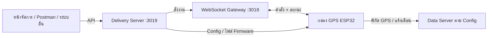

# คู่มือการใช้งาน ระบบจัดการกล่อง GPS (ESP32 Central Device Management)

> เวอร์ชันเอกสาร 2.0 · 19 ต.ค. 2569

---

## สารบัญ
1. ระบบนี้ทำอะไรได้
2. ภาพรวมระบบ
3. Firmware และ Schema
4. สิ่งที่ต้องเตรียม
5. เริ่มใช้งานครั้งแรก
6. หน้าจัดการ (Web Admin)
7. หน้าเว็บของกล่อง
8. ตั้ง Config ให้กล่อง
9. อัปเดต / ย้อนเวอร์ชัน Firmware
10. การแจ้งผลและสถานะคำสั่ง
11. สคริปต์สาธิต (Demo)
12. API สำหรับระบบอื่น
13. Postman
14. แก้ปัญหาเบื้องต้น
15. ความปลอดภัย
16. ไฟล์ในโปรเจกต์ / ข้อมูลอ้างอิง

---

## 1. ระบบนี้ทำอะไรได้

จัดการ **กล่อง GPS (ESP32)** หลายกล่องจากส่วนกลาง โดยไม่ต้องไปเสียบสายที่กล่อง

| ความสามารถ | ความหมาย |
|---|---|
| **สั่งงานทันที** | กล่องต่อ Server ค้างไว้ตลอด สั่งแล้วกล่องได้รับภายในไม่กี่วินาที |
| **เปลี่ยนค่า (Config) จากระยะไกล** | เปิด/ปิด LED, รอบส่ง GPS, ปลายทางข้อมูล, ความเร็วสูงสุด, พื้นที่ Geofence — ไม่ต้องแฟลชใหม่ |
| **อัปเดต / ย้อนเวอร์ชัน Firmware (OTA)** | ส่งไฟล์ .bin ให้กล่องในคำสั่งเดียว กล่องดาวน์โหลด ติดตั้ง และรีบูตเอง |
| **ปลอดภัย** | กล่องตรวจลายเซ็นดิจิทัลก่อนติดตั้ง และถ้า firmware ใหม่ใช้งานไม่ได้ จะย้อนกลับเวอร์ชันเดิมเอง |
| **ไม่ต้องลงทะเบียนกล่อง** | กล่องที่ต่อเข้ามาครั้งแรกจะถูกเพิ่มเข้าระบบอัตโนมัติ |
| **แจ้งผลทุกครั้ง** | สำเร็จ / ล้มเหลว พร้อมสาเหตุภาษาไทย ทั้งในหน้าจัดการ, API และส่งต่อไประบบอื่น (webhook) ได้ |

---

## 2. ภาพรวมระบบ



| ส่วนประกอบ | หน้าที่ | ที่อยู่ |
|---|---|---|
| **Delivery Server** | รับคำสั่งจากผู้ดูแล, เก็บ Config และไฟล์ Firmware, หน้าจัดการ | `http://192.168.1.100:3019` (บนเครื่องนี้ `http://localhost:3019`) |
| **WebSocket Gateway** | ช่องทางส่งคำสั่งถึงกล่องแบบ real-time และรับสถานะกลับ | `ws://192.168.1.100:3018/ws/device` |
| **กล่อง GPS (ESP32)** | อ่าน GPS, ส่งพิกัด, ทำตามคำสั่ง | หน้าเว็บในวง LAN เช่น `http://192.168.1.145` |
| **Data Server** | ปลายทางรับพิกัด GPS (แยกจากระบบจัดการ) | ตั้งใน Config (`data_server.host`) |
| **Data Monitor** | Data Server จำลอง + หน้าเว็บดูข้อมูลที่กล่องส่งเข้ามา | `http://localhost:320` (กล่องส่งมาที่ `http://192.168.1.100:320/api/gps`) |

> ตอนนี้ **เครื่องคอมนี้ (IP 192.168.1.100) ทำหน้าที่เป็น Server** — ต้องเปิดเครื่องและรัน Server ไว้ และต้องอยู่วงแลนเดียวกับกล่อง

**หลักการ:** Firmware กำหนดว่ากล่อง *ทำอะไรได้* → Schema กำหนดว่า *ตั้งค่าอะไรได้* → Config กำหนดว่า *แต่ละกล่องทำแบบไหน*

---

## 3. Firmware และ Schema

| เวอร์ชัน | ความสามารถ | Schema (ค่าที่ตั้งได้) |
|---|---|---|
| **1.0.0** | อ่าน GPS, ส่งพิกัด, LED สถานะ, รับ Config, OTA | 1: `led`, `gps`, `data_server` |
| **1.1.0** | + **ตรวจจับความเร็วเกิน** → event `OVERSPEED` | 2: + `speed_limit` |
| **1.2.0** | + **แจ้งเตือนเข้า/ออกพื้นที่** → event `GEOFENCE_EXIT` / `GEOFENCE_ENTER` | 3: + `geofence` |

- ไฟล์ firmware อยู่ที่ `firmware\dist\esp32_gps_box-<เวอร์ชัน>.bin` (สร้างด้วย `node firmware/build.js`)
- **ในไฟล์ .bin มีเลขเวอร์ชันฝังอยู่** — Server อ่านเองได้ ไม่ต้องกรอก
- **Schema** บน Server ตอนนี้มีแค่ **1** (ของ v1.0.0) — firmware ที่มีค่าตั้งใหม่ต้องเพิ่ม Schema ก่อน จึงจะตั้งค่านั้นได้ (ตัวอย่างอยู่ที่ `delivery-server\schema-examples\`)
- firmware ที่แค่แก้บั๊ก (เช่น 1.2.1) ใช้ Schema เดิมได้
- ระบบ**ไม่ยอม**ให้ตั้งค่าที่ firmware ในกล่องไม่รองรับ (เช่น speed limit บน v1.0.0)

> ความเร็วสูงสุดเป็นเพียง **เกณฑ์แจ้งเตือน** ไม่ได้ควบคุมรถจริง

---

## 4. สิ่งที่ต้องเตรียม

**ฮาร์ดแวร์:** ESP32 DevKit, โมดูล GPS GY-GPS6MV2 (NEO-6M), สาย USB, WiFi 2.4 GHz

| GPS | ESP32 |
|---|---|
| VCC | VIN (5V) |
| GND | GND |
| TX | GPIO13 |
| RX | ไม่ต้องต่อ |

**โปรแกรม (เครื่องที่เป็น Server):**
- **Node.js 20 ขึ้นไป**
- **Arduino IDE 2** + Board **esp32 by Espressif (3.x)** + Library: **TinyGPSPlus**, **ArduinoJson 7.x**, **WebSockets (Markus Sattler)**
- **Postman** (ถ้าจะทดสอบ API)

---

## 5. เริ่มใช้งานครั้งแรก

### 5.1 เปิด Server
1. ดับเบิลคลิก **`D:\arduino_gps\start-servers.bat`** → มีหน้าต่างดำ 2 หน้าต่าง (`ws-gateway (3018)`, `delivery-server (3019)`) — **ปล่อยเปิดไว้ตลอดการใช้งาน**
2. ครั้งแรก Windows Firewall จะถาม → กด **Allow** (Private network)
3. ทดสอบ: `http://localhost:3018/health` และ `http://localhost:3019/health` ต้องได้ `{"ok":true,...}`

> **แก้โค้ด Server หรือ `.env` แล้ว ต้องปิดหน้าต่างทั้งสองแล้วเปิด `start-servers.bat` ใหม่**

### 5.2 แฟลช Firmware v1.0.0 ลงกล่อง (ผ่าน USB ครั้งแรกครั้งเดียว)
1. Arduino IDE → **File → Open** → `D:\arduino_gps\firmware\esp32_gps_box\esp32_gps_box.ino`
2. **Tools**
   - Board: **ESP32 Dev Module**
   - **Partition Scheme: Minimal SPIFFS (1.9MB APP with OTA/128KB SPIFFS)** ← สำคัญที่สุด
   - Port: พอร์ตของ ESP32
3. กด **Upload**
4. ตรวจ: เปิด `http://<IP กล่อง>/api/status` → ค่า `ota_partition` ต้องเป็น **`running=app0 … next=app1`** (ถ้า `next=app0` แปลว่าเลือก Partition ผิด — OTA จะใช้ไม่ได้)

### 5.3 ตั้งค่ากล่อง
1. มือถือต่อ WiFi **`ESP32-GPS-Setup`** รหัส **`12345678`** → หน้าตั้งค่าเด้งขึ้นมา
   (กล่องที่เคยต่อ WiFi แล้ว: หน้าเว็บกล่อง → **เปลี่ยน WiFi (เข้าโหมดตั้งค่าใหม่)** หรือกดปุ่ม **BOOT** ค้าง 3 วินาที)
2. กรอก **WiFi + รหัส** และ **Device ID** (เช่น `BOX-0001` — **แต่ละกล่องห้ามซ้ำ**)
3. Gateway / Delivery URL มีค่าถูกต้องอยู่แล้ว ไม่ต้องแก้
4. กด **บันทึกและเชื่อมต่อ** → LED บนบอร์ด **ติดค้าง** = ต่อ Server แล้ว

**ไม่ต้องลงทะเบียนกล่อง** — ทุกกล่องใช้รหัสร่วมที่ฝังใน firmware กล่องจะขึ้นในหน้าจัดการเองเมื่อต่อ Server ครั้งแรก

---

## 6. หน้าจัดการ (Web Admin)

เปิด **`http://localhost:3019/admin`** (เครื่องอื่นในวงแลน: `http://192.168.1.100:3019/admin`)
เข้าสู่ระบบด้วยชื่อผู้ใช้ / รหัสผ่านใน `delivery-server\.env` (`ADMIN_USERNAME` / `ADMIN_PASSWORD`)

| แท็บ | ทำอะไรได้ |
|---|---|
| **กล่อง** | รายชื่อกล่อง, ออนไลน์/ออฟไลน์, เวอร์ชัน firmware, Config ที่ตั้ง / ที่กล่องใช้จริง, เห็นล่าสุด, **คำสั่งล่าสุด + สาเหตุถ้าล้มเหลว**, ปุ่ม **ระงับ** กล่อง |
| **Config** | เลือกกล่อง → ฟอร์มสร้างตาม firmware ที่กล่องรันอยู่ → **บันทึกและส่งไปที่กล่อง** → ดูความคืบหน้าทันที |
| **Firmware** | **ส่งไฟล์ .bin ให้กล่องอัปเดตทันที** (ติ๊ก "อนุญาตย้อนเวอร์ชัน" ได้), ดู/ลบ firmware ที่เก็บไว้, อัปโหลดเก็บไว้ก่อน / ส่งหลายกล่อง, ดู / เพิ่ม **Schema** |
| **ประวัติคำสั่ง** | คำสั่งทั้งหมดของแต่ละกล่อง พร้อมลำดับขั้นตอน, สาเหตุ, ยกเลิกคำสั่งที่ยังไม่เริ่ม |

---

## 7. หน้าเว็บของกล่อง

เปิด IP ของกล่อง (เช่น `http://192.168.1.145`) หรือ `http://esp32-gps.local`

| เมนู | แสดงอะไร |
|---|---|
| **GPS** (หน้าแรก) | สถานะ GPS, ไบต์ / NMEA / ดาวเทียม / ความเร็ว, พิกัด + Google Maps, NMEA, สถานะอุปกรณ์, ปุ่มเปลี่ยน WiFi |
| **Server / อัปเดต** | การเชื่อมต่อ Server, เวอร์ชัน + ฟีเจอร์, คำสั่งล่าสุด, **แถบความคืบหน้าการอัปเดต** |
| **Config** | ค่าที่กล่องใช้อยู่ทั้งหมด |
| **ส่งข้อมูล / แจ้งเตือน** | ปลายทาง Data Server, รอบส่ง, ผลการส่ง, แจ้งเตือน |
| **ประวัติ** | ลำดับเหตุการณ์ เช่น `led.enabled: true → false`, รีบูต, health check |
| **จำลองการขับ** | หน้าปัดความเร็ว + ปุ่มคันเร่ง / เบรก ใช้สาธิตการแจ้งเตือนความเร็วเกินโดยไม่ต้องขับจริง |

- **ยังไม่มีสัญญาณ GPS** → แสดงพิกัดเริ่มต้น `13.68035928547147, 100.60300413252199` พร้อมข้อความ "แสดงพิกัดเริ่มต้น" และส่งพิกัดนี้ไป Data Server พร้อม `"location_source": "default"`
- **ระหว่างอัปเดต** มีแถบสีฟ้า + % เหนือทุกหน้า และตอนรีบูต หน้าเว็บจะรอแล้วโหลดใหม่เอง
- **จำลองการขับ:** ข้อมูลที่ส่งออกระหว่างจำลองติดป้าย `"simulated": true` และปิดหน้าเว็บแล้วโหมดจำลองหยุดเองใน 5 วินาที

### ความหมายของ LED บนบอร์ด
| LED | ความหมาย |
|---|---|
| ติดค้าง | ต่อ Server แล้ว (ปกติ) |
| กระพริบช้า | มี WiFi แต่ยังต่อ Server ไม่ได้ |
| กระพริบสั้น ๆ | ยังไม่มี WiFi |
| กระพริบเร็ว | มีการแจ้งเตือน (ความเร็วเกิน / ออกนอกพื้นที่) |
| ดับ | ปิด LED ผ่าน Config |

---

## 8. ตั้ง Config ให้กล่อง

**บันทึกครั้งเดียว กล่องได้รับค่าใหม่ทันที** (กล่องออฟไลน์ = รอส่งเมื่อออนไลน์)

- **หน้าจัดการ:** แท็บ **Config** → เลือกกล่อง → แก้ค่า → **บันทึกและส่งไปที่กล่อง**
- **API:** `PUT /api/admin/devices/<device_id>/config` พร้อม `{"settings": {...}}`

| กติกา | รายละเอียด |
|---|---|
| ส่งเฉพาะค่าที่จะเปลี่ยนได้ | ค่าที่ไม่ได้ส่งมา **คงค่าเดิม** เช่น `{"settings":{"led":{"enabled":false}}}` |
| `data_server.host` ไม่บังคับ | ว่าง = กล่องไม่ส่งพิกัดไป Data Server |
| ห้ามใช้ IP / โดเมนนอกรายการอนุญาต | ตั้งรายการที่ `DATA_SERVER_HOST_ALLOWLIST` ใน `delivery-server\.env` |
| บันทึกอย่างเดียว ไม่สั่งกล่อง | เติม `?push=false` |
| รอผลจนกล่องทำเสร็จ | ใส่ header `X-Wait-Result: true` |

---

## 9. อัปเดต / ย้อนเวอร์ชัน Firmware

### ส่งไฟล์ให้กล่องอัปเดตทันที (วิธีหลัก)
- **หน้าจัดการ:** แท็บ **Firmware** → เลือกกล่อง + ไฟล์ .bin → **ส่งให้กล่องทันที**
- **API:** `POST /api/admin/devices/<device_id>/firmware` · Body = ไฟล์ .bin
- **Postman:** ข้อ **3.1**

กล่องจะ: **ดาวน์โหลด % → ตรวจลายเซ็น → ติดตั้ง → รีบูต → ผ่าน health check → สำเร็จ** (ประมาณ 20–60 วินาที)

| เรื่อง | การทำงาน |
|---|---|
| เลขเวอร์ชัน | อ่านจากไฟล์เอง — ถ้ากรอกมาแต่ไม่ตรงกับไฟล์จะถูกปฏิเสธ |
| ลายเซ็น | Server เซ็นให้เอง (กล่องตรวจลายเซ็นทุกครั้ง) |
| เวอร์ชันซ้ำบน Server | ทับให้เอง |
| กล่องใช้เวอร์ชันนี้อยู่แล้ว | ได้ 409 "ใช้ firmware vX อยู่แล้ว ไม่ต้องอัปเดต" |
| กล่องกำลังอัปเดตอยู่ | ได้ 409 และไม่แตะไฟล์ที่กล่องกำลังดาวน์โหลด |
| รอผลจนจบ | header `X-Wait-Result: true` (Postman ตั้งไว้แล้ว) |

### ย้อนเวอร์ชัน (Downgrade)
ส่งไฟล์เวอร์ชันเก่า (เช่น `esp32_gps_box-1.0.0.bin`) ด้วยวิธีเดียวกัน — **Postman ข้อ 3.1b**
- ตอนนี้อนุญาตให้ย้อนได้ (`ALLOW_FIRMWARE_DOWNGRADE=true` ใน `delivery-server\.env`)
- ถ้าตั้งเป็น `false` ต้องส่ง header `X-Allow-Downgrade: true` (หรือติ๊ก "อนุญาตย้อนเวอร์ชัน") จึงจะย้อนได้
- ค่าตั้งที่เวอร์ชันเก่าไม่รู้จัก (เช่น `speed_limit`) จะถูกข้าม ค่าอื่นยังอยู่ครบ

### Firmware ใหม่ที่มีค่าตั้งใหม่
1. เพิ่ม Schema ก่อน: หน้าจัดการ → แท็บ Firmware → **เพิ่ม Schema ใหม่ (JSON)** หรือ Postman **3.6**
   (ตัวอย่าง: `delivery-server\schema-examples\schema-2-firmware-1.1.0.json`)
2. ส่ง firmware ให้กล่อง
3. แท็บ **Config** จะมีช่องค่าใหม่ขึ้นมาเอง

### ขั้นสูง: เก็บไฟล์ไว้ก่อน / ส่งหลายกล่อง
`POST /api/admin/firmware` · Body = ไฟล์ .bin · header `X-Deploy-To: BOX-0001,BOX-0002` (หรือ `all`) — Postman ข้อ **3.4**

### ความปลอดภัยของการอัปเดต
1. กล่องตรวจ **SHA-256** และ **ลายเซ็น ECDSA** ด้วยกุญแจที่ฝังในกล่อง — ไม่ตรงไม่ติดตั้ง
2. ติดตั้งลงพื้นที่สำรอง แล้วรีบูต
3. firmware ใหม่ต้องต่อ Server ได้ภายใน 3 นาที ไม่อย่างนั้น **ย้อนกลับเวอร์ชันเดิมเอง** (`ROLLED_BACK`)

---

## 10. การแจ้งผลและสถานะคำสั่ง

| สถานะ | ความหมาย |
|---|---|
| `PENDING` | กล่องออฟไลน์ รอส่ง |
| `DELIVERED` | ส่งถึงกล่องแล้ว |
| `ACKNOWLEDGED` | กล่องรับคำสั่งแล้ว |
| `DOWNLOADING` / `VALIDATING` / `INSTALLING` / `REBOOTING` | ขั้นตอนอัปเดต firmware |
| `SUCCESS` | สำเร็จ (ยืนยันจากเวอร์ชัน / config ที่กล่องใช้จริง) |
| `FAILED` | ไม่สำเร็จ — ดู `error_message` (ภาษาไทย) และ `error_detail` |
| `ROLLED_BACK` | firmware ใหม่ใช้งานไม่ได้ กล่องย้อนกลับเวอร์ชันเดิมเอง |
| `EXPIRED` | ยกเลิก / ถูกแทนที่ด้วยคำสั่งใหม่ / หมดอายุ |

### กรณีไม่สำเร็จที่ระบบแจ้งให้อัตโนมัติ
| กรณี | ผล | ตั้งเวลาที่ `ws-gateway\.env` |
|---|---|---|
| กล่องออฟไลน์ คำสั่ง**ไปไม่ถึงกล่อง** | `FAILED` · `DEVICE_OFFLINE` | `COMMAND_DELIVERY_TIMEOUT_SEC=600` |
| กล่องรับคำสั่งแล้ว**เงียบหาย** | `FAILED` · `DEVICE_NO_RESPONSE` | `COMMAND_RESPONSE_TIMEOUT_SEC=180`, `COMMAND_REBOOT_TIMEOUT_SEC=300` |
| กล่อง**ทำไม่สำเร็จ** (ไม่รองรับค่า, ลายเซ็นผิด, พื้นที่ไม่พอ ฯลฯ) | `FAILED` + สาเหตุจากกล่อง | — |

### ช่องทางรู้ผล
1. **รอผลใน API เดียว:** header `X-Wait-Result: true` → ได้ผลสุดท้าย (สำเร็จ = HTTP 200/201, ไม่สำเร็จ = HTTP 500 พร้อม `message` ภาษาไทย)
2. **ดูภายหลัง:** `GET /api/gw/jobs/<command_id>` / หน้าจัดการแท็บ **ประวัติคำสั่ง**
3. **ส่งต่อไประบบอื่น (webhook):** ตั้ง `NOTIFY_WEBHOOK_URL` ใน `ws-gateway\.env` → ทุกคำสั่งที่จบจะ POST ผลไปให้
   ```json
   { "event": "COMMAND_FINISHED", "success": false, "command_id": "CMD-10016", "device_id": "BOX-0001",
     "action": "UPDATE_FIRMWARE", "status": "ROLLED_BACK", "error_code": "NEW_FIRMWARE_FAILED_HEALTH_CHECK",
     "error_message": "firmware ใหม่ต่อ Server ไม่ได้หลังรีบูต กล่องจึงย้อนกลับไปใช้เวอร์ชันเดิม" }
   ```

---

## 10.1 ดูข้อมูลที่กล่องส่งออก (Data Monitor)

ดับเบิลคลิก **`D:arduino_gpsstart-data-monitor.bat`** (แยกจาก start-servers.bat) แล้วเปิด **`http://localhost:320`** — แสดงข้อมูลที่กล่องส่งเข้ามาแบบ real-time และ**ทุกค่าที่ส่งมา** (ชื่อฟิลด์, ชนิด, ค่าล่าสุด)

1. ตั้ง Config ของกล่อง (แท็บ Config): **โปรโตคอล `http`**, **โฮสต์ `192.168.1.100`**, **พอร์ต `320`**, **API Path `/api/gps`**
2. กล่องส่งข้อมูลทุก `gps.send_interval_sec` วินาที (ค่าเริ่มต้น 10) — แม้ยังไม่มีสัญญาณ GPS (ส่งพิกัดเริ่มต้น + `location_source: "default"`)
3. ใช้เมนู **จำลองการขับ** ของกล่อง → เห็นความเร็วไหลเข้ามา (`simulated: true`) และแถวสีแดง `OVERSPEED` เมื่อเกินเกณฑ์ (v1.1.0+)

| ฟิลด์ | ความหมาย |
|---|---|
| `device_id` | กล่องที่ส่ง |
| `latitude` / `longitude` | พิกัด (ยังไม่มีสัญญาณ = พิกัดเริ่มต้น) |
| `location_source` | `gps` = พิกัดจริง · `default` = พิกัดเริ่มต้น (ยังไม่มีสัญญาณ) |
| `speed_kmh` | ความเร็ว กม./ชม. |
| `fix` / `satellites` | จับสัญญาณ GPS ได้ไหม / จำนวนดาวเทียม |
| `firmware_version` | เวอร์ชัน firmware ของกล่อง |
| `simulated` | มาจากโหมดจำลองการขับ |
| `timestamp` | เวลา UTC จาก GPS (ว่างถ้ายังไม่มีสัญญาณ) |
| `event_type` | (แจ้งเตือน) `OVERSPEED`, `GEOFENCE_EXIT`, `GEOFENCE_ENTER` + `speed_limit_kmh` / `distance_m` |

> IP ที่ใช้เป็นปลายทางได้ต้องอยู่ใน `DATA_SERVER_HOST_ALLOWLIST` ของ `delivery-server\.env` (ใส่ `192.168.1.100` ไว้แล้ว) · ข้อมูลทั้งหมดบันทึกที่ `data-monitor\data\`

---

## 11. สคริปต์สาธิต (Demo)

เปิดคู่กันบนจอ: **หน้าจัดการ** (`http://localhost:3019/admin`) และ **หน้าเว็บกล่อง** (`http://192.168.1.145`)

| # | ทำอะไร | ผู้ชมจะเห็น |
|---|---|---|
| 1 | แท็บ **กล่อง** | BOX-0001 ออนไลน์, firmware v1.0.0 |
| 2 | แท็บ **Config** → เอาติ๊ก "เปิดไฟ LED" ออก → บันทึกและส่ง | **LED บนบอร์ดดับทันที**, เมนูประวัติของกล่องขึ้น `led.enabled: true → false` |
| 3 | ชี้ว่าฟอร์ม Config ของ v1.0.0 **ไม่มีช่องความเร็วสูงสุด** | firmware ยังไม่รองรับ |
| 4 | เมนู **จำลองการขับ** ของกล่อง → เร่งเกิน 80 | v1.0.0 ไม่มีแจ้งเตือน |
| 5 | แท็บ Firmware → เพิ่ม Schema 2 (`schema-2-firmware-1.1.0.json`) | Schema 2 ขึ้นในตาราง |
| 6 | แท็บ Firmware → ส่ง `esp32_gps_box-1.1.0.bin` ให้ BOX-0001 | ดาวน์โหลด % → ตรวจลายเซ็น → ติดตั้ง → **รีบูต** → สำเร็จ, หน้าเว็บกล่องขึ้น **v1.1.0** |
| 7 | แท็บ **Config** → ช่อง **ความเร็วสูงสุด** โผล่มา → เปิด + ตั้ง 80 → ส่ง | ค่าตั้งเปลี่ยนตาม firmware อัตโนมัติ |
| 8 | เมนู **จำลองการขับ** → กดคันเร่งค้างจนเกิน 80 นาน 3 วินาที | **แจ้งเตือน: ความเร็วเกิน**, LED กระพริบเร็ว, event `OVERSPEED` |
| 9 | ส่ง `esp32_gps_box-1.0.0.bin` (ย้อนเวอร์ชัน) | กล่องรีบูตกลับเป็น v1.0.0 |
| 10 | แท็บ **ประวัติคำสั่ง** | ทุกคำสั่งพร้อมขั้นตอนและผล |

### เคสเสริม
- **กล่องออฟไลน์:** ถอดไฟ → ส่ง Config (ได้ "รอกล่องออนไลน์") → เสียบไฟคืน → กล่องได้รับเองแล้วขึ้น **สำเร็จ**
- **กันตั้งค่าผิด:** ใส่โฮสต์ปลายทางเป็น IP → ถูกปฏิเสธพร้อมเหตุผล
- **ระงับกล่อง:** แท็บกล่อง → **ระงับ** → กล่องต่อ Server ไม่ได้ทันที

---

## 12. API สำหรับระบบอื่น

ที่อยู่: **`http://192.168.1.100:3019`** · ทุกคำขอใส่ `Authorization: Bearer <ADMIN_TOKEN>`

**ขอ token:**
```
POST /api/login        {"username":"admin","password":"..."}   →  {"token":"<ADMIN_TOKEN>"}
```

| ทำอะไร | Method + Path | หมายเหตุ |
|---|---|---|
| รายชื่อกล่อง + ออนไลน์ + คำสั่งล่าสุด | `GET /api/gw/devices` | |
| รายชื่อกล่อง + Config ที่ตั้ง / ที่รายงาน | `GET /api/admin/devices` | |
| Config ตั้งไว้ vs กล่องใช้จริง | `GET /api/admin/devices/<id>/config` | `in_sync` |
| **ตั้ง Config (ส่งให้กล่องทันที)** | `PUT /api/admin/devices/<id>/config` | `{"settings":{...}}`, `?push=false`, `X-Wait-Result` |
| **ส่ง firmware ให้กล่องทันที** | `POST /api/admin/devices/<id>/firmware` | Body .bin, `X-Wait-Result`, `X-Allow-Downgrade` |
| ผลคำสั่ง | `GET /api/gw/jobs/<command_id>` | `status`, `error_message`, `events` |
| ประวัติคำสั่ง | `GET /api/gw/devices/<id>/commands` | |
| ยกเลิกคำสั่ง | `POST /api/gw/jobs/<command_id>/cancel` | เฉพาะที่ยังไม่เริ่ม |
| Schema ทั้งหมด / เพิ่ม | `GET` / `POST /api/admin/schemas` | |
| firmware ที่เก็บไว้ / เก็บ / ลบ | `GET` / `POST /api/admin/firmware`, `DELETE /api/admin/firmware/ESP32-DEVKIT-V1/<ver>` | `X-Deploy-To`, `X-Replace` |
| ระงับกล่อง | `POST /api/gw/devices/<id>/revoke` และ `POST /api/admin/devices/<id>/revoke` | |

> พิกัด GPS ไม่ได้อยู่ใน API นี้ — กล่องส่งพิกัดไปที่ Data Server ตาม Config โดยตรง (ดูพิกัดสด ๆ ได้ที่ `http://<IP กล่อง>/api/status`)

---

## 13. Postman

Import ไฟล์ **`postman\ESP32-Management.postman_collection.json`** (ไม่ต้องมี environment — เลือก "No Environment")
ตัวแปรอยู่ที่ collection → แท็บ **Variables** (ปกติแก้แค่ `device_id`)

```
0. เริ่มต้น       → Login (ทำก่อนทุกครั้ง)
1. ดูข้อมูลกล่อง
2. ตั้ง Config    → 2.1–2.4 (กล่องได้รับทันที + รอผล)
3. Firmware       → 3.1 ส่งไฟล์ให้กล่อง · 3.1b ย้อนเวอร์ชัน · 3.2 ดูความคืบหน้า · 3.3–3.7 ขั้นสูง
4. ประวัติ / ยกเลิก / ระงับกล่อง
5. จำลองเป็นกล่อง (ทดสอบโดยไม่มีกล่องจริง)
```
ระบบอื่น (คนละเครื่อง) ให้แก้ตัวแปร `base_url` เป็น `http://192.168.1.100:3019` — รายละเอียดเพิ่มใน `postman\README.md`

---

## 14. แก้ปัญหาเบื้องต้น

| อาการ | สาเหตุที่พบบ่อย | วิธีแก้ |
|---|---|---|
| หน้าจัดการ / Postman ต่อไม่ได้ | Server ไม่ได้เปิด | ดับเบิลคลิก `start-servers.bat` |
| แก้แล้วแต่ไม่เห็นผล | Server ยังรันโค้ดเก่า / เบราว์เซอร์จำหน้าเก่า | เปิด `start-servers.bat` ใหม่ · กด **Ctrl+F5** |
| กล่องขึ้น "กำลังเชื่อมต่อ Server..." ค้าง | Server ปิด / Firewall / URL ผิด / กล่องถูกระงับ | เปิด Server, อนุญาต Firewall พอร์ต 3018–3019, ตรวจ URL ในหน้าตั้งค่ากล่อง |
| Serial ขึ้น `[report] HTTP 401` | Device ID / รหัสไม่ถูก / ถูกระงับ / firmware ในกล่องเก่า | แฟลช firmware ล่าสุด, ตรวจ Device ID |
| GPS: "ยังไม่ได้รับข้อมูลจาก GPS" | สายหลวม / ต่อผิดขา | GPS TX → GPIO13, GND ร่วมกัน |
| ดาวเทียม 0 | อยู่ในอาคาร | นำเสา GPS ไปที่โล่ง รอ 1–5 นาที |
| อัปเดตได้ `NO_OTA_PARTITION` / `UPDATE_BEGIN_FAILED` | แฟลชครั้งแรกเลือก Partition ผิด (`next=app0`) | แฟลชใหม่ผ่าน USB ด้วย **Minimal SPIFFS (1.9MB APP with OTA)** |
| อัปเดตได้ `ROLLED_BACK` | firmware ใหม่รีสตาร์ท / ต่อ Server ไม่ได้หลังรีบูต | สั่งใหม่อีกครั้ง ถ้าเป็นซ้ำ ดู Serial Monitor หลัง `REBOOTING` |
| สั่งอัปเดตแล้ว "สำเร็จ" แต่ไม่รีบูต | (แก้แล้ว) ส่งเวอร์ชันเดียวกับที่กล่องใช้ | ตอนนี้ได้ 409 "ใช้เวอร์ชันนี้อยู่แล้ว" |
| ส่ง firmware ได้ `VERSION_MISMATCH` | กรอกเวอร์ชันไม่ตรงกับไฟล์ | ไม่ต้องกรอก ปล่อยให้ระบบอ่านจากไฟล์ |
| ตั้ง Config ได้ `INVALID_CONFIG` | ค่าเกินช่วง / firmware ไม่รองรับ / host เป็น IP | อ่าน `details` ในผลตอบกลับ |
| ตั้ง Config ได้ `UNKNOWN_SCHEMA` / `SCHEMA_MISMATCH` | ยังไม่มี Schema ของ firmware ที่กล่องรัน | เพิ่ม Schema (แท็บ Firmware) |
| คำสั่งได้ `DEVICE_OFFLINE` | กล่องออฟไลน์เกิน 10 นาที | เปิดกล่อง แล้วสั่งใหม่ |
| หน้าเว็บกล่อง "ส่งล่าสุด" HTTP error | Data Server ยังไม่มี API รับข้อมูล | ไม่กระทบการจัดการกล่อง |

---

## 15. ความปลอดภัย

- **ห้ามแสดงบนจอ / ห้ามแชร์:** ไฟล์ `.env` ทั้งสอง Server (มี `ADMIN_TOKEN`, รหัสผ่านหน้าจัดการ), รหัสกล่องร่วม (`DEFAULT_DEVICE_TOKEN` ใน firmware)
- **Private key** สำหรับเซ็น firmware: `delivery-server\keys\firmware-signing-private.pem` — อยู่บนเครื่อง Server เท่านั้น
  - เพราะ Server เซ็นให้อัตโนมัติ (`SIGN_ON_UPLOAD=true`) **ใครมีรหัสผ่านหน้าจัดการ = ส่ง firmware ที่กล่องยอมรับได้** → ควรเปลี่ยนรหัสผ่าน `admin123` ให้เดายาก
  - ถ้าสร้างกุญแจใหม่ ต้องแก้ `signing_key.h` และแฟลชทุกกล่องใหม่
- **รหัสกล่องร่วม `1234`** เดาง่าย — เหมาะกับการสาธิต ใช้งานจริงควรเปลี่ยนให้ยาวขึ้น (แก้ `DEFAULT_DEVICE_TOKEN` + `AUTO_REGISTER_TOKEN` ใน `.env` ทั้งสองไฟล์ แล้วแฟลชทุกกล่อง)
- ตอนนี้รันในวงแลนด้วย `ws://` / `http://` (ไม่เข้ารหัส) — ใช้งานจริงบน Internet ควรใช้ `wss://` / `https://` (กล่องรองรับแล้ว)
- รหัส WiFi ตั้งค่าของกล่อง (`12345678`) ควรเปลี่ยน (`AP_PASS` ใน `globals.h`)

---

## 16. ไฟล์ในโปรเจกต์ / ข้อมูลอ้างอิง

```text
D:\arduino_gps\
├── start-servers.bat        ดับเบิลคลิกเพื่อเปิด Gateway + Delivery
├── start-data-monitor.bat   ดับเบิลคลิกเพื่อเปิด Data Monitor (พอร์ต 320)
├── ws-gateway\              WebSocket Gateway (พอร์ต 3018) · .env
├── delivery-server\         Delivery Server + หน้าจัดการ (พอร์ต 3019) · .env
│   ├── admin\               หน้าจัดการ
│   ├── schemas\             Schema ที่ใช้งาน
│   ├── schema-examples\     ตัวอย่าง Schema ของ 1.1.0 / 1.2.0
│   ├── keys\                กุญแจเซ็น firmware (ห้ามแชร์ private key)
│   └── data\                ข้อมูลกล่อง / Config / firmware ที่เก็บไว้
├── firmware\
│   ├── esp32_gps_box\       โค้ด firmware (เปิด .ino ใน Arduino IDE)
│   ├── build.js             build ทั้ง 3 เวอร์ชัน → dist\
│   └── dist\                ไฟล์ .bin สำหรับส่งให้กล่อง
├── data-monitor\            Data Server จำลอง + หน้าเว็บดูข้อมูลที่ไหลเข้ามา (พอร์ต 320)
└── postman\                 Postman collection + README
```

| รายการ | ค่า |
|---|---|
| Server (เครื่องนี้) | IP `192.168.1.100` · Gateway พอร์ต **3018** · Delivery พอร์ต **3019** |
| หน้าจัดการ | `http://localhost:3019/admin` |
| WiFi ตั้งค่ากล่อง | `ESP32-GPS-Setup` / `12345678` |
| หน้าเว็บกล่อง / API กล่อง | `http://<IP กล่อง>/` · `http://<IP กล่อง>/api/status` |
| Serial Monitor | 115200 baud |
| Hardware model | `ESP32-DEVKIT-V1` |
| ย้ายเครื่อง / IP เปลี่ยน | แก้ `PUBLIC_BASE_URL` ใน `delivery-server\.env` + URL ในหน้าตั้งค่ากล่อง · ย้ายเครื่องให้คัดลอกทั้งโฟลเดอร์รวม `data\` และ `keys\` |

เอกสารเพิ่มเติม: `ESP32_Central_Device_Management_Spec.md` (สเปกระบบ), `postman\README.md`, `firmware\README.md`
